# Graph DB Viewer — server edition

**Query, visualize and edit your graph database, right in the browser.**

**Source, full documentation and issues: [github.com/EECSB/GraphDBViewer](https://github.com/EECSB/GraphDBViewer)** · **[Try it live](https://eecs.blog/BlazorApps/GraphDBViewer/)**

A browser-based viewer and editor for graph databases. Paste a query, get a picture, poke at the data, and
move on. Six engines: **Gremlin** (Apache TinkerPop, Azure Cosmos DB), **Cypher** (Neo4j, Memgraph),
**AQL** (ArangoDB), **DQL** (Dgraph), **GUN** and **SPARQL/RDF**. See your data as an interactive **2D** or
**3D** graph, a **table**, raw **JSON**, or on a **map** or a **globe**, then edit it and commit the changes back.

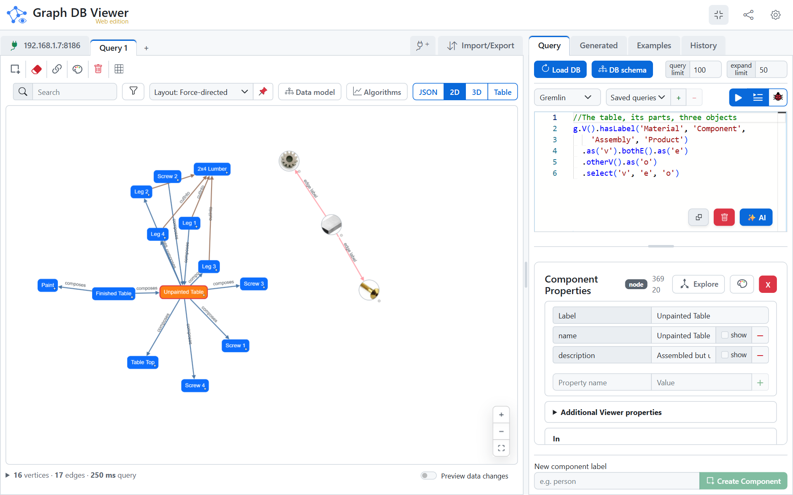

```
docker run --rm -p 8080:8080 eecsb/graphdbviewer-server
```

Then open <http://localhost:8080>. Or with Compose:

```yaml
services:
  graphdbviewer:
    image: eecsb/graphdbviewer-server
    ports:
      - "8080:8080"
    restart: unless-stopped
```

Images are published for **amd64 and arm64**, so a Raspberry Pi or an Apple-silicon Mac runs the same tag.

---

## What the container adds

The viewer normally talks to a database **straight from the browser** and needs no server at all — the
[GitHub releases](https://github.com/EECSB/GraphDBViewer/releases) ship a zip of static files for exactly
that. This image is the same app **plus a small ASP.NET Core host**, and the host exists for the four things
a browser will not do, however it is written:

| | |
|---|---|
| **No CORS headers** | A browser discards a cross-origin response the database did not explicitly permit. Most database servers send no such headers, and plenty cannot be configured to. |
| **Mixed content** | A page served over `https` may not open a plain-`http` connection. A database without TLS is unreachable from any hosted page. |
| **Private addresses** | A database on `10.x`, or behind a VPN, is reachable from your server and not from a visitor's browser. |
| **Bolt** | Neo4j and Memgraph speak a protocol that rides a raw TCP socket. No browser will open one. |

Each connection carries a **Make requests from** toggle — *Browser* or *Server* — so the proxy is used per
connection, only where it is needed. The app asks the host for `api/graph/capabilities` at startup, so one
build works either way: served as static files it gets a 404, hides the toggle, and stays browser-direct.

---

## Highlights

| | |
|---|---|
| 🔌 **Six engines** | Gremlin (TinkerPop, Cosmos DB), Cypher (Neo4j, Memgraph), AQL (ArangoDB), DQL (Dgraph), GUN and SPARQL/RDF. |
| 🌍 **Map and Globe** | Vertices that carry coordinates on a world map or a 3D globe, found by the property names data already uses, with the earth's imagery shipped in the app. |
| 🎨 **Six view modes** | The same result as **JSON**, an interactive **2D** graph, a **3D** graph, or a sortable **Table** — and, for vertices that carry coordinates, on a **Map** or a **Globe**. |
| 🧭 **Multiple layouts** | 7 layouts in 2D (force, cluster by label, tree, concentric, circle, grid, random) and 6 in 3D (force plus five DAG modes). |
| 🐞 **Query debugger** | Step through a traversal and watch the traverser count after every step — see exactly where results vanish. |
| ✏️ **Full editing** | Add, edit and delete vertices, edges and properties. Changes are staged and committed explicitly. |
| 🧠 **Schema-aware autocomplete** | Monaco editor with real vertex labels, edge labels and property keys pulled from your live database. |
| ✨ **Ask in English** | Describe what you want and a model writes the query against your live schema — bring your own key (Anthropic, OpenAI, Gemini, or any OpenAI-compatible endpoint). |
| ✨ **Text to knowledge graph** | Paste text, a document or a Wikipedia article and get a graph out, previewed and merged before anything is committed. |
| 🖌️ **Styling and detailed view** | Color, size, icon and 3D model per label or per node, vertices drawn as cards, and whole stylings kept as named stylesheets. |
| 📊 **Graph algorithms** | Degree, PageRank, betweenness, connected components, Louvain communities and shortest paths, computed in the browser for every database. |
| 🤖 **Claude, through an MCP server** | Claude Code or Claude Desktop can query the database a viewer tab is connected to, through that tab, as you watch. |
| 📥 **Import** | Paste GraphSON, **Graphviz DOT** or **Mermaid** and visualize it offline — or turn it into `addV`/`addE`. |
| 📤 **Export** | Table → CSV or colored Excel; graph → PNG, JPEG, SVG; 3D scene → OBJ, PLY, STL, glTF. |
| 🌙 **Six themes + PWA** | Dark, light and tinted themes with tuned contrast, persisted, keyboard shortcuts, and installable/offline via a service worker. |

---

## Supported databases

| Database | Query language | Protocol | Route |
|---|---|---|---|
| Apache TinkerPop / TinkerGraph | Gremlin | WebSocket or HTTP | Browser or server |
| Azure Cosmos DB (Gremlin API) | Gremlin | WebSocket / HTTP + HMAC-SHA256 | Browser or server |
| Neo4j / Memgraph | Cypher | Bolt | Browser (vendored JS driver) or server (.NET driver) |
| ArangoDB | AQL | HTTP cursor API | Browser or server |
| Dgraph | DQL | HTTP | Browser or server |
| GUN | — (form-based) | peer-to-peer | Browser only — the page *is* a peer |
| Fuseki, Blazegraph, GraphDB, Virtuoso | SPARQL 1.1 | HTTP | Browser or server |
| Public SPARQL (Wikidata, DBpedia) | SPARQL | HTTPS | Browser or server |

Not every engine can do everything, and where one cannot it is a reason rather than an unfinished job:
GUN cannot enumerate itself, so it has no browse; SPARQL has no query builder, so every
compose-a-query-for-you feature is off for it.

**Amazon Neptune** stays out of scope: it needs VPC access plus SigV4 request signing, which is more than
a proxy.

> **Reachability.** On the Browser route the endpoint must be reachable from your machine *and* either
> allow CORS (HTTP/SPARQL) or accept a WebSocket from your origin; the app shows a warning to remind you.
> This image is what lifts that — it dials from the host instead, which is the whole reason it exists.

---

## The same result, six ways

**2D** — Cytoscape.js, with 7 layouts, directed labeled edges and selection highlighting:

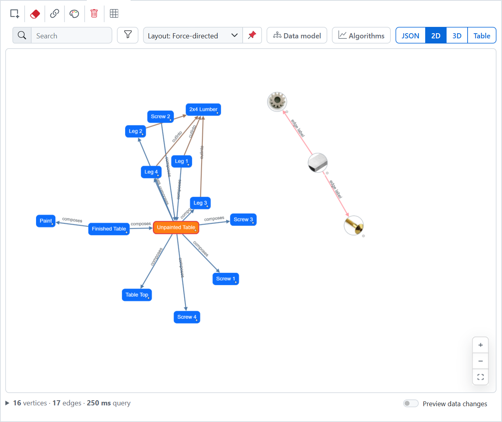

**3D** — three.js, with 6 layouts including five DAG modes, coloring by label, directional arrows and curved parallel edges:

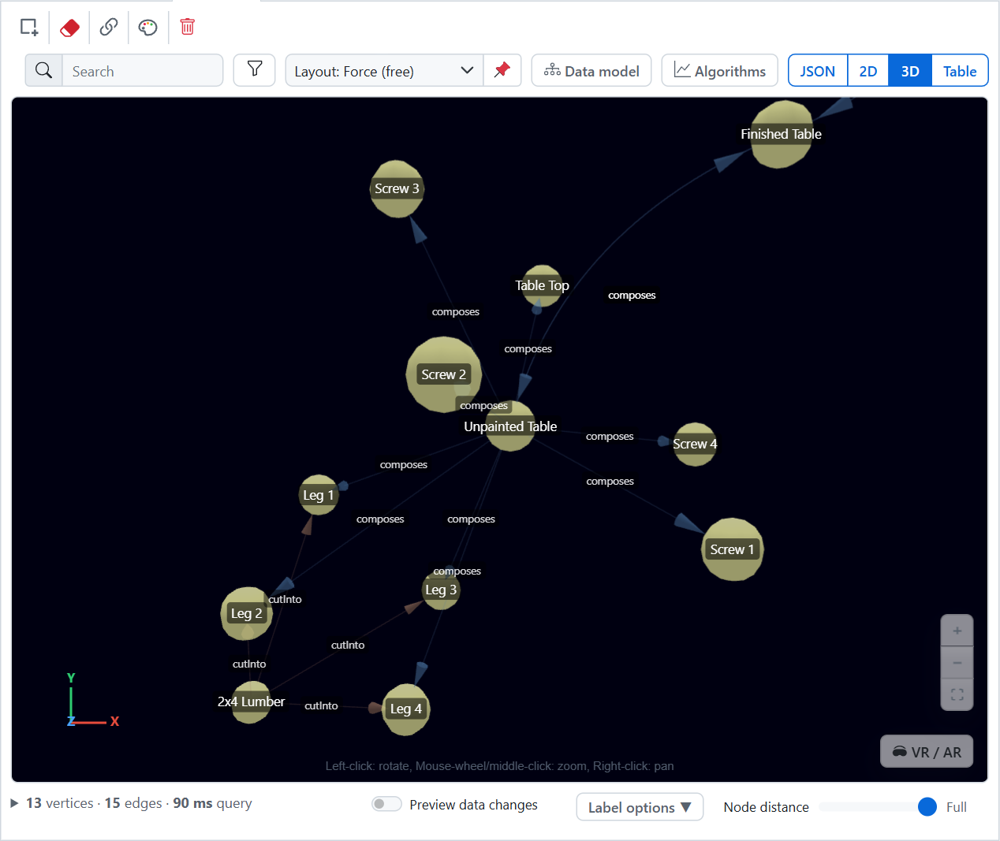

**Table** — vertices and edges with one column per property, exportable to CSV or a colored Excel sheet:

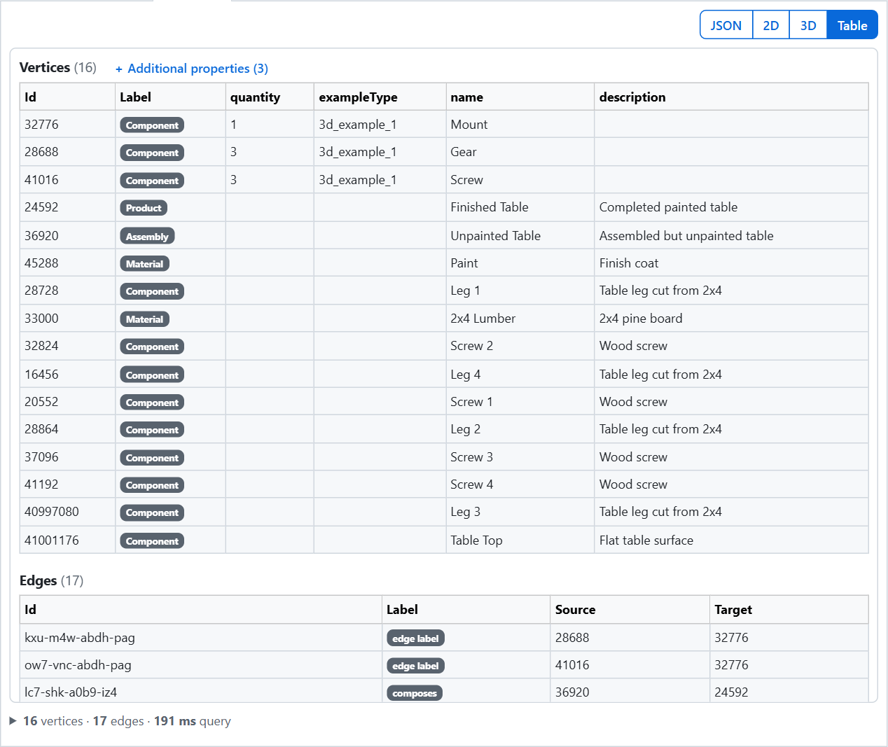

**JSON** — the raw result, exactly as the database answered:

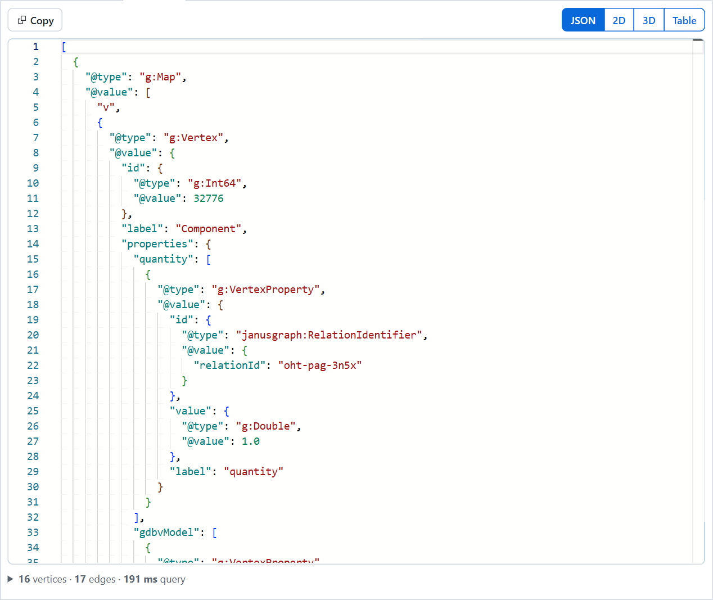

**Detailed view** — a switch per label draws each vertex as a card with its label, name and properties:

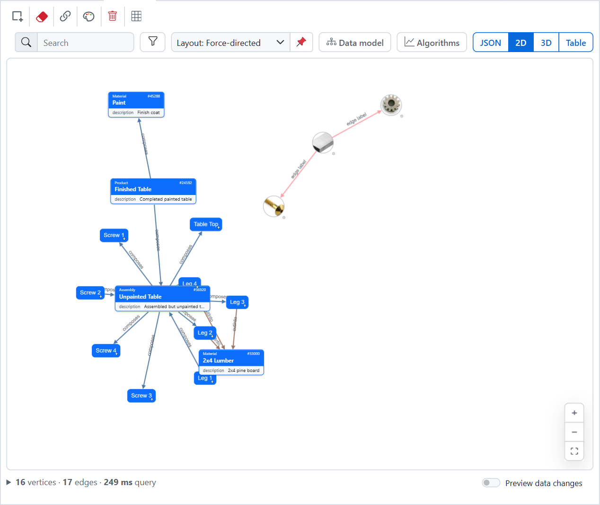

**Styling** — color, size, display property, icon and 3D model, per vertex label or per node:

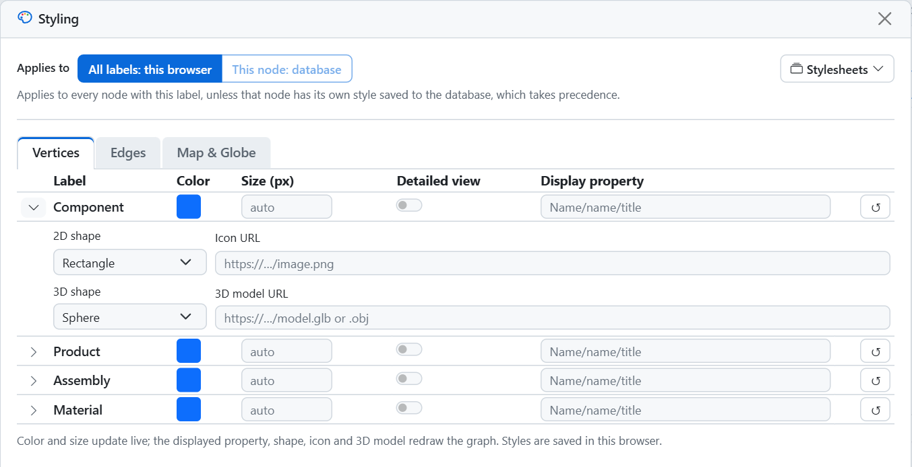

Also on every graph:

- **Search and filter** — find nodes by label, id or property value, and show or hide vertices by label.
- **Graph algorithms** — vertices sized or colored by the result and listed in the table; they work on imported data too.
- **Double-click to expand** — grow the graph outward from a node by loading its neighbors.
- **Multiple query tabs** — each an independent workspace with its own query, results, view, layout, styling and selection, restored on reload.
- **Graph stats** — vertex and edge counts under each graph, plus the last query's execution time.

---

## Map and Globe

Vertices that carry coordinates can be drawn where they are: hover **2D** and pick **Map** for a world map, or
hover **3D** and pick **Globe**.

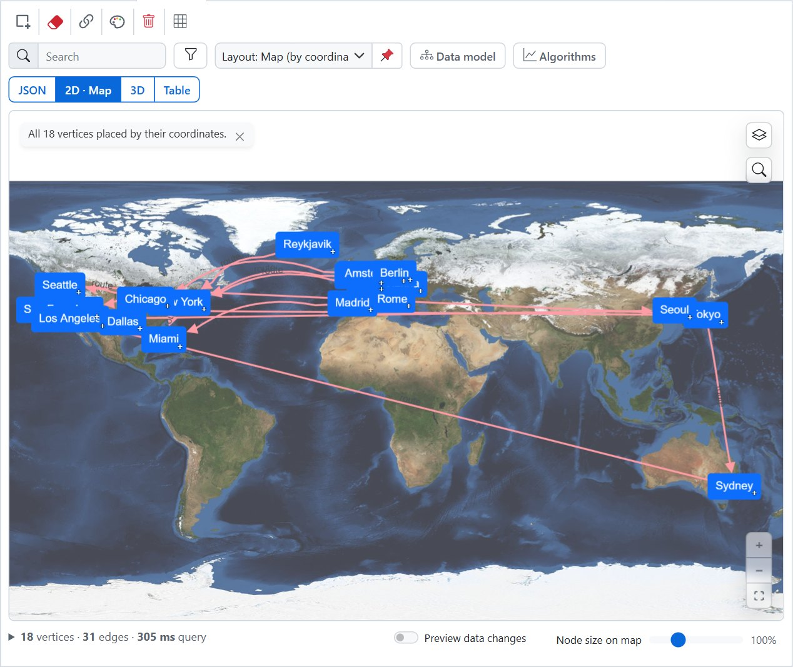

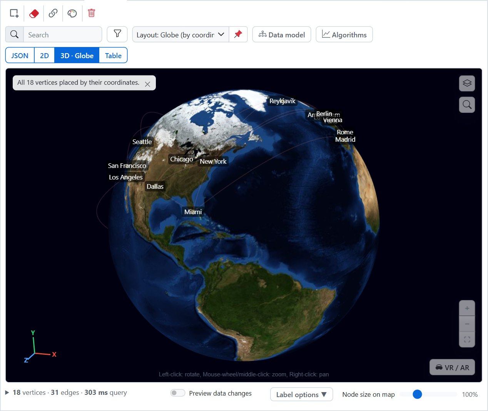

- **Nothing to configure** — coordinates are found by convention: `lat` / `latitude` with `lon` / `lng` / `long` / `longitude`, or one property holding both (`"48.2, 16.4"`, a GeoJSON point, WKT `POINT(lon lat)`, a Neo4j point).
- **Still the same view** — selecting, editing, styling, filtering, searching and exporting work as they do on the plain 2D and 3D graphs.
- **No tile server needed** — **Satellite** (NASA Blue Marble) and **Outline** (Natural Earth) ship with the app, so there is no key and no outside service to reach unless you choose one.
- **Or draw it from a server** — free street, topographic and satellite tile servers are in the layers menu; Map settings takes your own server, a commercial one, or Google's Map Tiles API with your own key.
- **Find a place** — look up an address or a place's name and go there, with a pin and its coordinates to copy. Nothing is sent until you press Enter, and the geocoder can be a Photon or a Nominatim you run.

To try it, run **Geospatial map** from *Examples → Sample graphs* (Gremlin or Cypher): eighteen cities and the routes between them.

---

## Write and run queries

Monaco, self-hosted, with syntax highlighting for Gremlin, openCypher and SPARQL, and autocomplete drawn
from your live schema — real labels and property keys, not a generic word list:

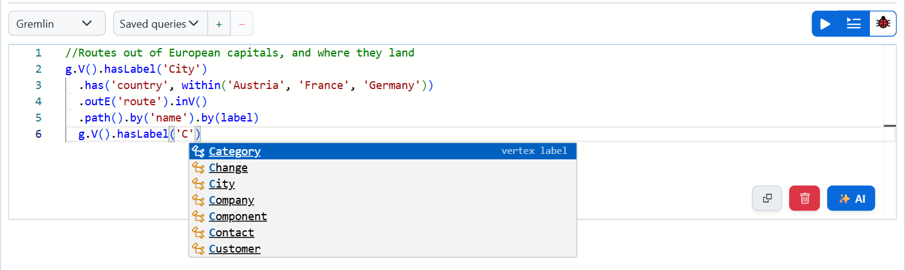

- **Load DB** — pull the whole graph, vertices and edges, with a configurable vertex limit.
- **Saved queries and history** — stored locally, one click to bring one back.
- **Examples** — curated queries, plus one-click **sample graphs**: a table-assembly tree, a social network, flight routes, 3D objects, and cities on a map.
- **✨ AI** — a running conversation that writes the query into the editor for review, grounded in the connected schema. Tool-capable models can run queries to check themselves under a per-panel setting: ask each time (the default), auto-run reads, or auto-run reads and writes.
- **Cancellable** — connect, Run Query, Load DB, Schema fetch and Commit all have a Cancel button.

## The query debugger

Step through a Gremlin traversal and watch the traverser count after each step. The step where the count
drops to zero is the step that ate your results:

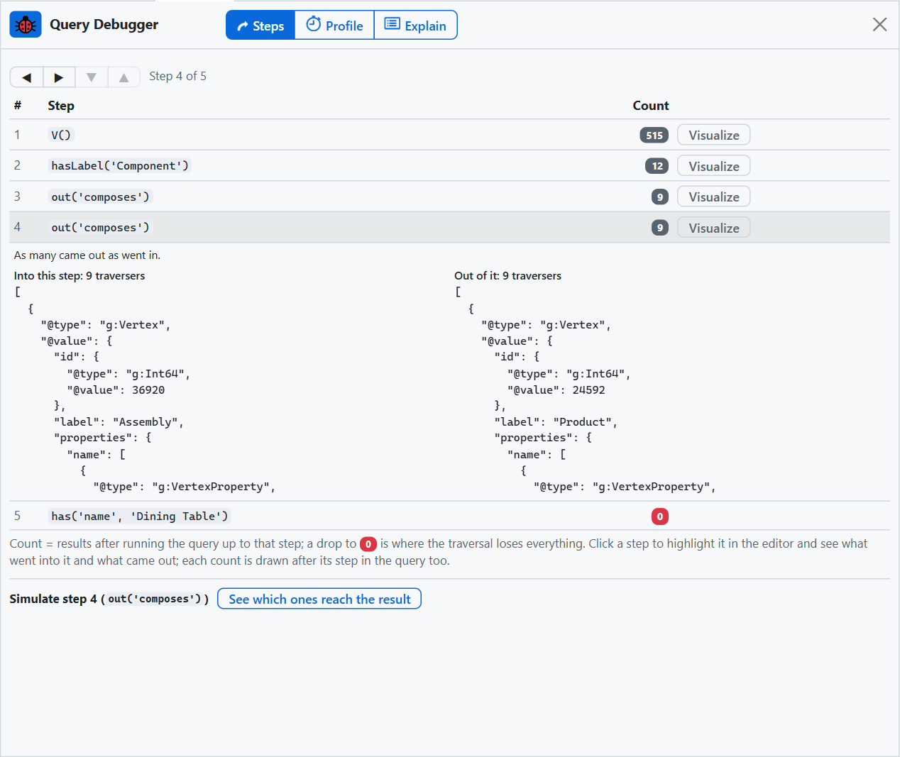

Click a step in the editor to sample it or visualize that intermediate result, read the **Profile** and **Explain**
tabs, and debug without worry: `addV`, `addE`, `drop`, `property` and `merge` queries are refused, so debugging
never changes your graph.

## Edit the graph safely

- **Select** a node or edge, in the graph or in a table row, to open the property editor.
- **Add, edit and remove** vertex and edge properties, add and remove edges in either direction, and create edges with two clicks.
- **Create** a vertex by label; **delete** with a button, the Delete key, or a delete mode. Deleting a vertex also drops its edges, so none are left dangling.
- Every change is staged into a **Generated queries** buffer and **committed explicitly**, with per-line error reporting, so nothing changes until you say so.
- **Preview uncommitted edits** on the 2D or 3D canvas before you commit.

## Import and export

- **Paste** GraphSON, Graphviz DOT or Mermaid flowcharts and visualize them with no connection; DOT and Mermaid also generate `addV` / `addE` for a real database.
- **✨ Generate with AI** — paste text, load a file (PDF, `.docx`, `.xlsx`, `.csv`, text) or fetch a Wikipedia article, and a model extracts a knowledge graph: validated, de-duplicated, previewed, then staged to merge into or replace the current drawing.
- **Table** → CSV or a color-styled Excel `.xlsx`. **Image** → PNG, JPEG, or SVG. **3D scene** → OBJ, PLY, STL or glTF.

---

## Claude, through an MCP server

`gdbv-mcp` lets Claude, in Claude Code or Claude Desktop, query the database a viewer tab is connected to, through
that tab, as you watch. It runs on your own computer rather than in this image; a tab opened at
`http://localhost:8080` can link to it as it is, and a viewer on another address needs that address added with
`--link-origin`. It may only read until you tick **Let it change the database** on the card in
**Settings → AI settings**. Setup is in the
[README](https://github.com/EECSB/GraphDBViewer#claude-through-an-mcp-server).

---

## Optional: a local Gremlin database to play with

Nothing to connect to yet? Run one beside this container:

```
docker run -d -p 8182:8182 tinkerpop/gremlin-server
```

That serves an **in-memory TinkerGraph** at `ws://localhost:8182/gremlin` — no SSL, and the data is lost
when the container restarts. Connect in the app with: type **Apache TinkerPop**, transport **WebSocket**,
**SSL off**, host `localhost`, port `8182`.

It starts empty, so load something into it: the **Examples** tab has one-click **sample graphs** that add
themselves to whatever is already there.

No Docker to spare? Pick the **SPARQL / RDF** database type and the public **Wikidata** endpoint
`https://query.wikidata.org/sparql` — zero setup — and try:

```
SELECT * WHERE { ?s ?p ?o } LIMIT 10
```

---

## Read this before exposing it

**The proxy endpoint is unauthenticated and dials whatever it is asked to.** That is the feature — it is a
developer tool, and pointing it at an arbitrary endpoint is the point — but it means anything that can
reach this container can make it open connections on its behalf, including to addresses only it can route
to. **Do not put this on the open internet.**

**Credentials travel to the host.** On the Server route a connection's key is sent here rather than staying
in the browser. TLS is expected to terminate at a reverse proxy in front of the container; the app serves
plain HTTP on 8080.

**Keys are stored in plain text** in the browser, which suits a single-user developer tool; do not use it on
a shared machine with production credentials.

## What it is not

There are no accounts, no database and no server-side storage. Your workspace stays in the browser's
IndexedDB exactly as it does without a host, so the container holds nothing and can be replaced freely.

A full-stack platform with accounts and saved workspaces that follow a user between machines is a separate
product (Treeality).

---

## Tags

- `latest` — the newest release
- `1.3.0` and so on — one for each release

## License

Source-available under the [PolyForm Noncommercial License 1.0.0](https://github.com/EECSB/GraphDBViewer/blob/main/LICENSE).
Noncommercial use — personal and hobby projects, research, education, nonprofits — is free. Commercial use
requires a paid license; see
[COMMERCIAL-LICENSE.md](https://github.com/EECSB/GraphDBViewer/blob/main/COMMERCIAL-LICENSE.md).

Source and documentation: <https://github.com/EECSB/GraphDBViewer>
